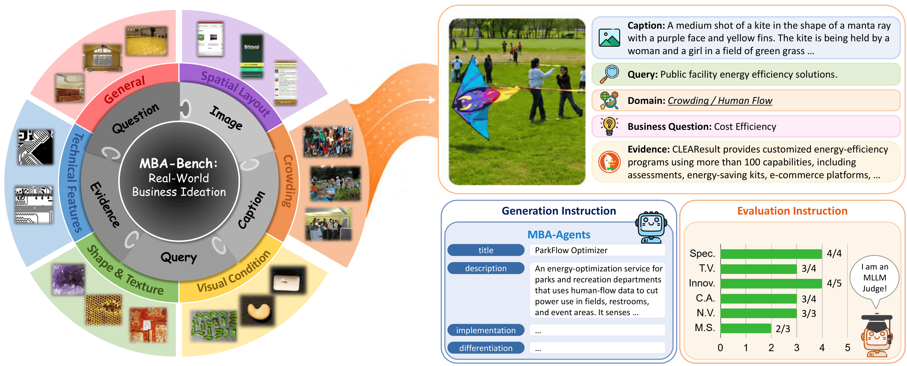
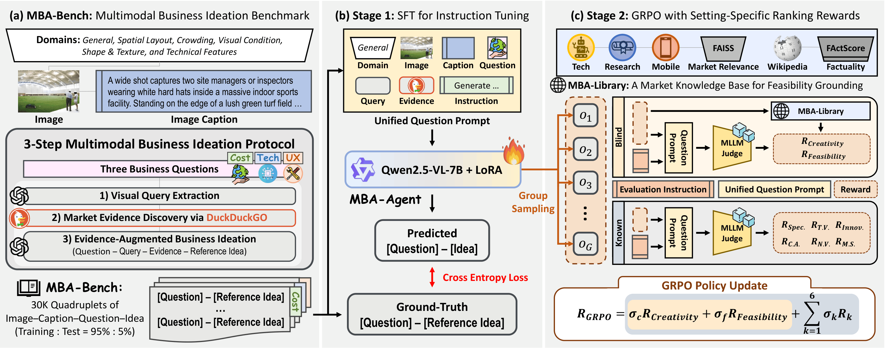
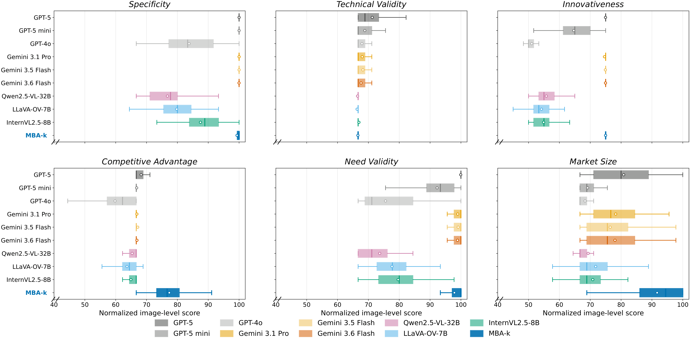

# MBA: Multimodal Benchmark and Agents for Real-World Business Ideation


<div align="center">
  <a href="https://hchoi256.github.io/" target="_blank">Hojun&nbsp;Choi</a> &ensp; <b>&middot;</b> &ensp;
  <a href="https://j-mayo.github.io/" target="_blank">Jaeyo&nbsp;Shin</a> &ensp; <b>&middot;</b> &ensp;
  <a href="https://adios42.github.io/" target="_blank">Suin&nbsp;Lee</a> &ensp; <b>&middot;</b> &ensp;
  <a href="https://scholar.google.co.kr/citations?user=KB5XZGIAAAAJ&hl=ko" target="_blank">Hyunjung&nbsp;Shim</a> <br>
  KAIST AI &emsp;<br>
</div>
<br/>

<p align="center">
  <a href="https://arxiv.org/abs/2608.11616">
    
  </a>
  <a href="https://huggingface.co/hchoi256/mba/tree/main">
    
  </a>
  <a href="https://hchoi256.github.io/projects/mba/">
    
  </a>
</p>


This repository is a PyTorch official code of the paper [MBA: Multimodal Benchmark and Agents for Real-World Business Ideation](https://arxiv.org/abs/2608.11616).

## News & Updates
  <!-- - [x] **[2026/06/18]** ✈️ Our paper is accepted to ECCV 2026! -->
  - [x] **[2026/xx/xx]** 📝 Our paper is now available! The paper is released [here](https://arxiv.org/abs/2608.11616).
  - [x] **[2026/xx/xx]** 🧑‍💻 Our code is released!

## Table of Contents
- [1. Environment Setting and Dataset Preparation](#1-environment-setting-and-dataset-preparation)
  - [Environment Setting](#environment-setting)
  - [1-1. MBA-Library](#1-1-mba-library)
  - [1-2. MBA-Bench](#1-2-mba-bench)
- [2. Training](#2-training)
  - [Stage 1. SFT](#stage-1-sft)
  - [Stage 2. GRPO](#stage-2-grpo)
- [3. Inference](#3-inference)
- [Acknowledgement](#acknowledgement)
- [Citation](#citation)

## MBA: Multimodal Benchmark and Agents for Buisness Ideation

<p align="center">
  
</p>

In this work, MBA introduces two contributions for business ideation: a benchmark for multimodal business ideation (**MBA-Bench**), and two dedicated agents, (**MBA-b and MBA-k**).
Together, they enable novel and feasible business ideas grounded in diverse real-world modalities.
The detailed design is described as a following figure:
<br />

<p align="center">
  
</p>


## 1. Environment Setting and Dataset Preparation

**MBA-Library** and **MBA-Bench** are available [🤗here](https://huggingface.co/hchoi256/mba/blob/main/mbabench.zip).

### Environment Setting

```bash
# Init a Conda Env
. setup.sh
source /workspace/activate_mba.sh

# Download required packages
python -m pip install \
  --no-cache-dir \
  --force-reinstall \
  --no-deps \
  "numpy==1.26.4" \
  "triton==2.2.0"
sudo apt-get update
sudo apt-get install -y unzip wget
```


### 1-1. MBA-Library

```bash
# Create a Conda Env for MBA-Library
. /workspace/src/MBALibrary.sh

# else if the environmnet already exists,
# deactivate
source /opt/conda/etc/profile.d/conda.sh
conda activate /workspace/data/conda/envs/MBALibrary
```

#### FAISS
```bash
# Download MBA-Library
python 0_prepare_market_evidence.py \
  --base_dir /workspace/data/mba \
  --out_dir /workspace/data/mba/mbalibrary \
  --sources_dir /workspace/data/mba/mbalibrary/sources \
  --keep_old_mbalibrary \
  --max_mobilerec 20000 \
  --max_openalex 100000 \
  --max_wikidata 100000 \
  --openalex_per_term 2000 \
  --wikidata_per_query 25000 \
  --batch_size 128
```

#### FActScore
* You should access the file from the browser [enwiki-20230401.db](https://drive.google.com/uc?id=1Qu4JHWjpUKhGPaAW5UHhS5RJ545CVy4I).
* Put the file to `FActScore/data/enwiki-20230401.db`
* This process should create `FActScore/data/enwiki-20260101-fts.db`.


```bash
# Download required packages
python -m pip install "rank-bm25==0.2.2"
```

```bash
# Update the 2023 Wikipedia database for 2026
. src/factscore1.sh
. src/factscore2.sh

# Download an LLM for atomic decomposition
python /workspace/download_mistral_for_factscore.py
```

```bash
# Build FTS5 Index for fast FActScore computation
cd /workspace/FActScore
python build_fts.py
cd ../
```

### 1-2. MBA-Bench

#### Dataset Preparation

```bash
bash /workspace/src/ade.sh
bash /workspace/src/rico.sh
bash /workspace/src/coco_spatial.sh
bash /workspace/src/visa.sh
bash /workspace/src/dtd.sh
bash /workspace/src/deeppcb.sh
```

```bash
read -rsp "Hugging Face token: " HF_TOKEN
echo
export HF_TOKEN

# Generating image captions
bash /workspace/caption.sh
```


#### DuckDuckGo Retrieval

```bash
export OPENAI_API_KEY="YOUR_API_KEY"
```

```bash
# DDG Generation
DDG_IMAGE_WORKERS=8 \
GENERATE_IMAGE_WORKERS=6 \
WEB_TIMEOUT=20 \
DDG_SLEEP=0.1 \
FETCH_SLEEP=0 \
MAX_VARIANTS_PER_QUERY=3 \
MAX_FETCH_CANDIDATES_PER_QUERY=3 \
DDG_RETRY_WORKERS=2 \
DDG_MAX_IMAGE_ATTEMPTS=0 \
bash /workspace/src/run_ddg.sh
```
* Delete `source_manifest_2k.jsonl` and rerun the command to retry failed samples and regenerate the file with updated results.


#### Reference Idea Generation

1. OpenAI API

```bash
DDG_IMAGE_WORKERS=8 \
GENERATE_IMAGE_WORKERS=6 \
WEB_TIMEOUT=20 \
DDG_SLEEP=0.1 \
FETCH_SLEEP=0 \
MAX_VARIANTS_PER_QUERY=3 \
MAX_FETCH_CANDIDATES_PER_QUERY=3 \
DDG_RETRY_WORKERS=2 \
DDG_MAX_IMAGE_ATTEMPTS=0 \
OPENAI_MAX_RETRIES=5 \
IDEA_MAX_OUTPUT_TOKENS=1200 \
bash /workspace/src/run_ideation.sh
```

2. Gemini API

```bash
export GEMINI_API_KEY="YOUR_GEMINI_API_KEY"
```

```bash
GEMINI_MODEL=gemini-3.5-flash \
GEMINI_THINKING_LEVEL=minimal \
GEMINI_REQUEST_TIMEOUT_MS=180000 \
GENERATE_IMAGE_WORKERS=6 \
GEMINI_MAX_RETRIES=5 \
IDEA_MAX_OUTPUT_TOKENS=1200 \
GEMINI_MAX_ESTIMATED_COST_USD=0 \
bash /workspace/src/run_ideation_gemini.sh
```

#### Sanity Check
```bash
# sanity check 1
bash /workspace/src/sanity_check.sh

# === expert JSON ===
# 1999
# === combined expert JSONL ===
# 1999 /workspace/data/mba/expert_data/all_expert_trajectories.jsonl
# === manifest ===
# 1999 /workspace/data/mba/source_manifest_2k.jsonl
# === DDG ===
# 5997 /workspace/data/mba/ddg_marketdb.jsonl
# === images ===
# 1999
# === captions ===
# 1999
```

----


## 2. Training

We trained on 8 NVIDIA A6000 GPUs.

```bash
conda deactivate
source /workspace/activate_mba.sh
```

### Stage 1. SFT

```bash
CUDA_VISIBLE_DEVICES=0,1,2,3,4,5,6,7 torchrun --standalone --nproc_per_node=8 2_sft.py
```

### Stage 2. GRPO

1. MBA-b
```bash
MBA_GRPO_OUTPUT_DIR=/workspace/checkpoints/grpo_b \
CUDA_VISIBLE_DEVICES=0,1,2,3,4,5,6,7 \
python -u 3_grpo.py \
  --no_resume \
  --logprob_microbatch 2 \
  --generation_microbatch 8 \
  --judge_axis_batch_size 6 \
  --policy_gradient_checkpointing on \
  --branch_type closed
```

2. MBA-k
```bash
MBA_GRPO_OUTPUT_DIR=/workspace/checkpoints/grpo_k \
CUDA_VISIBLE_DEVICES=0,1,2,3,4,5,6,7 \
python -u 3_grpo.py \
  --no_resume \
  --logprob_microbatch 2 \
  --generation_microbatch 8 \
  --judge_axis_batch_size 6 \
  --policy_gradient_checkpointing on \
  --branch_type open \
  --no_auxiliary
```
* `--no_auxiliary`: optionally disable two auxiliary rewards to speed up training

----

## 3. Inference

Pre-trained models are available [🤗here](https://huggingface.co/hchoi256/mba/tree/main/checkpoints).

1. MBA-b
```bash
CUDA_VISIBLE_DEVICES=0,1,2,3,4,5,6,7 \
python -u 4_eval.py \
  --model_type grpo \
  --grpo_adapter /workspace/checkpoints/grpo_b \
  --output_dir /workspace/output/eval_grpo_b
```

2. MBA-k
```bash
CUDA_VISIBLE_DEVICES=0,1,2,3,4,5,6,7 \
python -u 4_eval.py \
  --model_type grpo \
  --grpo_adapter /workspace/checkpoints/grpo_k \
  --output_dir /workspace/output/eval_grpo_k
```

## Model Comparison

> **Bold** indicates the best score across **all models**. <u>Underlined</u> indicates the second-best score across **all models**.
> Tied scores receive the same formatting. Higher scores are better.

<p align="center">
  
</p>

### Closed-Source Models

| Model                  | Specificity | Technical Validity | Innovativeness | Competitive Advantage | Need Validity | Market Size |
| :--------------------- | ----------: | -----------------: | -------------: | --------------------: | ------------: | ----------: |
| GPT-4o                 |        3.51 |               3.04 |           3.04 |                  2.79 |          2.27 |        2.05 |
| GPT-5-mini             |    **4.00** |               3.07 |           3.59 |                  3.00 |          2.77 |        2.07 |
| GPT-5                  | <u>3.99</u> |               3.08 |           3.97 |           <u>3.27</u> |          2.44 |        2.10 |
| Claude-Sonnet-4.6      |        3.88 |           **3.16** |           3.78 |                  3.24 |          2.58 |        2.16 |
| Gemini-3.5-Flash       |    **4.00** |               3.05 |       **4.00** |                  3.01 |      **2.97** |        2.29 |
| Gemini-3.1-Pro-Preview |    **4.00** |               3.04 |    <u>3.98</u> |                  3.01 |      **2.97** | <u>2.35</u> |

### Open-Source Models

| Model                    | Specificity | Technical Validity | Innovativeness | Competitive Advantage | Need Validity | Market Size |
| :----------------------- | ----------: | -----------------: | -------------: | --------------------: | ------------: | ----------: |
| LLaVA-OneVision-Qwen2-7B |        3.39 |               2.99 |           3.17 |                  2.91 |          2.33 |        2.15 |
| InternVL2.5-8B           |        3.62 |               3.01 |           3.19 |                  2.95 |          2.39 |        2.12 |
| InternVL2.5-26B          |        3.58 |               3.01 |           3.27 |                  2.97 |          2.46 |        2.20 |
| Qwen2.5-VL-7B-Instruct   |        3.60 |               3.06 |           3.15 |                  2.62 |          2.32 |        1.94 |
| Qwen2.5-VL-32B-Instruct  |        3.50 |               2.99 |           3.23 |                  2.96 |          2.21 |        2.08 |
| **MBA-7B-SFT (Ours)**    |        3.68 |               3.09 |           3.22 |                  2.57 |          2.31 |        1.99 |
| **MBA-b-7B (Ours)**      |        3.64 |        <u>3.12</u> |    <u>3.98</u> |                  3.19 |          2.38 |        2.20 |
| **MBA-k-7B (Ours)**      |        3.98 |               3.00 |       **4.00** |              **3.32** |   <u>2.94</u> |    **2.75** |


## Acknowledgement

Our code is strongly based on [GPT-4o](https://arxiv.org/pdf/2410.21276). We sincerely appreciate to the following works:
  - [PBIG](https://aclanthology.org/2025.agentscen-1.4.pdf)
  - [Qwen](https://github.com/QwenLM/qwen)

## Citation

```bibtex
TBD
```
